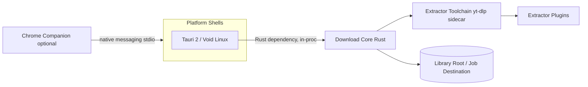
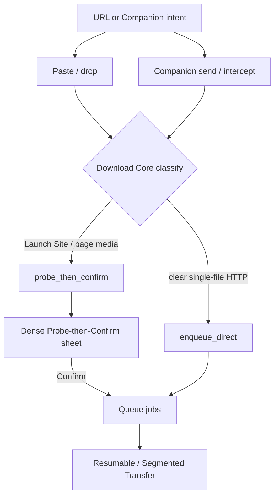
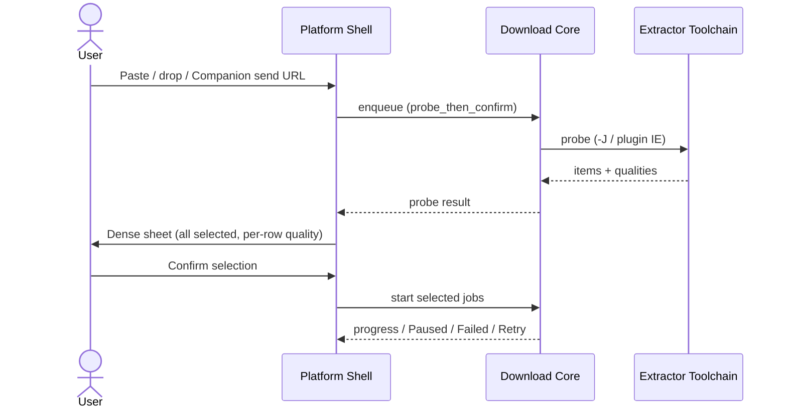
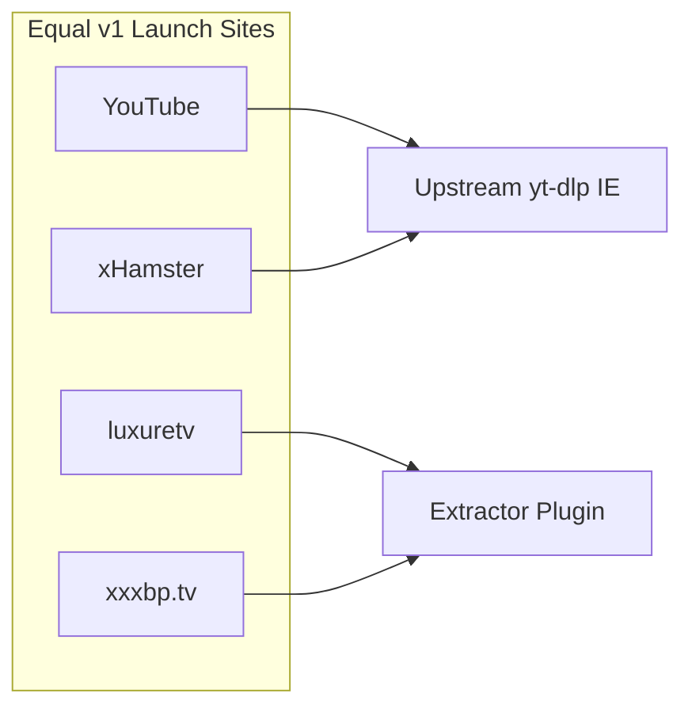

# Phlegethon hand-off spec

Product + engineering specification for implementation kickoff. Decisions locked on [Wayfinder: Phlegethon hand-off spec](https://github.com/soubarnak/phlegethon/issues/1) are recorded here once; research notes and UI prototypes are assets, not peer sources of truth.

**Status:** **hand-off accepted** (map [#1](https://github.com/soubarnak/phlegethon/issues/1) signed off 2026-07-20) — implementation may start. Remaining fog stays under [§ Deferred / open](#11-deferred--open).

**Amended 2026-10-14:** the Windows shell was dropped, the single shell is Tauri 2 on Void Linux and the only release artifact is an xbps package ([ADR 0001](../adr/0001-drop-windows-shell.md)), and the design system is IBM Carbon instead of Geist ([ADR 0002](../adr/0002-carbon-design-system.md)). Sections 1, 3.1, 4, 6.1, 6.2, 6.5, 8.1, 9 and 11 below reflect that; the rest is unchanged.

---

## 1. Purpose & Destination

Phlegethon is a desktop **Download Manager** with first-class **Video Intelligence**, shipping on Void Linux (glibc and musl) as an xbps package. This document is the **Hand-off Spec**: clear enough that implementation can start without reopening locked product, platform, download-architecture, Launch Site, UI, and Companion decisions.

This effort does **not** build or ship the app. Implementation begins only after human sign-off on the map.

---

## 2. Vocabulary

Canonical terms live in [`CONTEXT.md`](../../CONTEXT.md). Spec language must match that glossary. Key terms used below: Download Manager, Video Intelligence, Launch Site, Download Core, Platform Shell, Extractor Toolchain, Extractor Plugin, Probe-then-Confirm, Library Root, Job Destination, Resumable Transfer, Segmented Transfer, Mirror Set, Bandwidth Cap, Chrome Companion, Hand-off Spec.

---

## 3. Product scope

### 3.1 What ships in v1 (desktop)

| Area | v1 commitment |
| --- | --- |
| Product shape | Universal download manager + video intelligence (not video-only) |
| Platforms | Void Linux, glibc and musl (Tauri 2 shell over the Rust Download Core); released as an xbps package only |
| URL entry | Paste / drop URLs must work alone for desktop MVP |
| Launch Sites | Four equal must-haves: YouTube, xxxbp.tv, luxuretv, xHamster (see matrix) |
| HTTP depth | Resumable Transfer, Segmented Transfer, Mirror Sets, Bandwidth Caps; queue parity with video jobs |
| Storage | Library Root + per-job Job Destination; batch/channel → dedicated subfolder |
| Chrome Companion | Designed in this spec; **not required** for desktop MVP |

### 3.2 Launch Sites

Four sites are **equal v1 must-haves**. Minimum bar is single-video probe + quality list; multi-item lists where the site supports them and where this matrix requires them.

### 3.3 Non-goals

See [§ Non-goals](#non-goals) (map Out of scope set).

---

## 4. Platform & architecture

### 4.1 Shell

| OS | Platform Shell | UI toolkit |
| --- | --- | --- |
| Void Linux (glibc, musl) | Native host | Tauri 2 (WebKitGTK webview) with React and IBM Carbon |

One shell, one Rust **Download Core**. Other Linux distributions are expected to build from source but are not release targets.

### 4.2 Shell ↔ Core (locked)

The Tauri backend links `download-core` as an ordinary Rust dependency (`rlib`). Tauri commands wrap the Core API; the frontend calls them through `@tauri-apps/api`. Core events are drained on a background thread and pushed to the webview as a `core-event` event. There is no C ABI and no second process.

Long operations (probe, yt-dlp downloads) never run while holding the Core mutex: the Core splits each into a plan made under the lock, a run outside it, and a finish step under the lock again, so the queue stays responsive.

**Escape hatch:** a sidecar process over a local socket if extractor or Core crashes must not take the shell down.

### 4.3 Void Linux target

- Release artifact: an xbps package from [`packaging/void/srcpkgs/phlegethon/template`](../../packaging/void/srcpkgs/phlegethon/template). Tauri's own bundler (deb, AppImage, rpm) is disabled.
- No systemd assumptions (Void uses runit). The companion socket is an `interprocess` local socket.
- Folder chooser: `xdg-desktop-portal` when it is on the bus, else `zenity` or `kdialog`, else a typed path (`phlegethon-shell-support`).
- Desktop notifications: the notification plugin, with `notify-send` as fallback.
- Dependencies at runtime: `yt-dlp`, `ffmpeg`, a JavaScript runtime (`nodejs`) for YouTube, `xdg-utils`, `xdg-desktop-portal`, `dbus`.

### 4.4 System context

---

## 5. Download Core behavior

### 5.1 Enqueue classification

The Download Core owns intent classification. Companion (when present) may tag a capture; the Core decides `enqueue_direct` vs `probe_then_confirm`.

| Source | Typical path |
| --- | --- |
| Paste / drop Launch Site or page-media URL | `probe_then_confirm` |
| Paste / drop clear single-file HTTP(S) | may `enqueue_direct` |
| Companion explicit send (URL ± session) | Core classifies; Launch Site pages never skip confirm |
| Companion download intercept | usually `enqueue_direct` for clear single-file HTTP |
| Companion direct media URL | plain HTTP / Resumable Transfer — **not** Launch Site Video Intelligence acceptance |

### 5.2 Enqueue paths diagram

### 5.3 Storage

- **Library Root** — user-chosen base directory for all downloads.
- **Job Destination** — per-job folder, always owned by the job: unique under the Library Root by default, or a unique subfolder under a user-picked absolute parent when Save-to overrides it (see `CONTEXT.md`). The job never treats a shared user folder as its destination.
- Batch / channel jobs use a **dedicated subfolder** derived from the source.

### 5.4 Transfer behavior (all job types)

| Capability | v1 |
| --- | --- |
| Queue parity (video + general HTTP) | Same Library Root / Job Destination / Paused · Failed · Retry |
| Resumable Transfer | In — retry/backoff; explicit Paused / Failed / Retry until complete or discarded |
| Segmented Transfer | In — multi-connection Range when allowed; single-connection fallback |
| Mirror Sets | In — Metalink / `.meta4` + page-local lists + user-added URLs |
| Bandwidth Cap | In — optional global + per-job; default uncapped |
| Browser intercept into Phlegethon | Designed via Companion; not required for desktop MVP |

### 5.5 Probe-then-Confirm flow

Default multi-item UX: **dense sheet** — checklist + per-row quality, sticky Confirm, all selected by default. Downloads start only after explicit confirmation.

---

## 6. Extractor Toolchain

### 6.1 Packaging

Drive **yt-dlp** as a managed **sidecar** (CLI + `-J`/`-j` JSON probe). The Core finds it in this order: the app sidecar directory (installed from the Toolchain panel), `YTDLP_PATH`, `yt-dlp` on `PATH`, then `python3 -m yt_dlp`. The Toolchain panel can install the latest GitHub release into the sidecar directory, verified against the release's `SHA2-256SUMS`.

Also needed:

- **ffmpeg / ffprobe**
- For full YouTube: **yt-dlp-ejs** and a JS runtime. The Core detects deno (2.3 or newer), node (22 or newer), quickjs or bun and passes `--js-runtimes`. Fetching the EJS components from GitHub (`--remote-components ejs:github`) is off until the user turns it on.

| libc | Binary shape |
| --- | --- |
| glibc (x86_64, aarch64, armv7l) | `yt-dlp_linux`, `yt-dlp_linux_aarch64`, `yt-dlp_linux_armv7l` standalone builds |
| musl | The universal `yt-dlp` zipimport script, which needs `python3`; or the xbps `yt-dlp` package |

When the site is behind a browser check, the Core adds `--impersonate chrome` if `curl_cffi` is available.

Do not use you-get / gallery-dl as the primary toolchain. The xbps `yt-dlp` package is the default install, and the sidecar exists so Launch Site fixes do not wait for a distro update.

Detail: [`docs/research/extractor-toolchain.md`](../research/extractor-toolchain.md).

### 6.2 Extractor Plugins

**luxuretv** and **xxxbp.tv** have no first-party yt-dlp extractors. Coverage is **Phlegethon-owned yt-dlp Extractor Plugins** shipped as app-managed sidecar assets, **updateable independently** of a full app release.

Native Download Core handlers only if a site cannot be expressed as a yt-dlp IE.

Post-ship plugin rot → **degraded Launch Site allowed** (explicit Failed / unsupported UX); fixes ship out-of-band via the plugin update path — do not freeze app releases on plugin rot.

### 6.3 Launch Site acceptance matrix

| Launch Site | Coverage mechanism | Single-video + quality | Multi-item lists |
| --- | --- | --- | --- |
| YouTube | Upstream yt-dlp (+ ejs/JS for full support) | **Required** | **Required** where supported (channel / playlist / user) |
| xHamster | Upstream yt-dlp | **Required** | **Required** where supported |
| luxuretv | Extractor Plugin | **Required** | Best-effort / later — **not** required for equal status |
| xxxbp.tv | Extractor Plugin | **Required** | Best-effort / later — **not** required for equal status |

### 6.4 Shared failure policy

1. **Hard-fail** the Launch Site path when the dedicated extractor / plugin cannot resolve the URL.
2. **No silent yt-dlp generic fallback** as “Launch Site supported.”
3. Degraded post-ship coverage is OK with explicit Failed / unsupported UX.
4. A Companion-fed **direct media URL** may enqueue as ordinary HTTP / Resumable Transfer; that does **not** count as Launch Site Video Intelligence acceptance.

### 6.5 Tiered extraction for every other site

The failure policy above applies to the four Launch Sites only. For any other URL the Core tries, in order, and tags the result with the tier that worked:

| Tier | What happens | Shown as |
| --- | --- | --- |
| Direct file | A HEAD request reports a non-HTML body (video, audio, archive, ...) | Original file, plain HTTP |
| Dedicated | A yt-dlp extractor made for the site resolves it | No warning |
| Generic extractor | yt-dlp's `Generic` extractor resolves it | Warning: "Generic extraction" |
| Page scan | The Core reads the page for `og:video`, `<video>`/`<source>`, JSON-LD, media links and inline script URLs (hover previews are ignored) | Warning: found by scanning the page |
| Failure | Nothing worked | Error with both reasons and a "Try plain download" action |

Each tier after Dedicated can be switched off in Settings, and the probe has a timeout. "Try plain download" enqueues the URL as an ordinary HTTP transfer without probing.

Sites behind a Cloudflare challenge (luxuretv) fail with an actionable "needs browser cookies" error instead of a generic one; the user supplies cookies under Settings.

---

## 7. Chrome Companion

Designed in this spec; **not required** for desktop MVP (paste/drop suffice).

### 7.1 Capability boundary (courier only)

1. **No in-browser Video Intelligence** — no probe or quality pick in the extension. Desktop always owns Probe-then-Confirm for Launch Site / page media URLs.
2. **Explicit send:** context menu on link, context menu on page, toolbar/action (current tab). Shortcuts / omnibox out of designed set.
3. **Opt-in download intercept** (default **off**). Unreachable / reject / cancel before job start → fall back to Chrome’s normal download. Explicit send always remains.
4. **Optional session handoff** via explicit per-send gesture (“Send with cookies” or equivalent). Intercept may attach same-origin session only after prior opt-in / first-intercept confirm. Exact cookie / session payload schema is deferred.
5. **Intent classification lives in Download Core** (see §5.1).

### 7.2 Transport

| Path | Role |
| --- | --- |
| Native messaging (stdio host) | **Sole** Companion ↔ desktop data path |
| Custom URI scheme | Launch / focus only — never session material |
| Extension-facing loopback HTTP | **Rejected** (LNA / CSRF) |

Installer registers Chrome **and** Chromium host locations; thin NMH forwards a versioned JSON envelope into the shell (named pipe / Unix socket).

Detail: [`docs/research/chrome-companion-bridge.md`](../research/chrome-companion-bridge.md).

---

## 8. UI flows

### 8.1 Design system

**IBM Carbon** through `@carbon/react`, theme **g10** (light) and **g100** (dark), following the system preference and persisted per user. IBM Plex Sans and Mono are bundled locally, so the app works offline and under a strict CSP. Use Carbon components as they are (DataTable, Modal, Tabs, Tag, ProgressBar, Toggle, Dropdown, notifications); recolor nothing by hand. Status colors come from Carbon `Tag` types: gray pending, blue downloading, teal paused, green completed, red failed. User-facing strings live in `packages/shell-strings/en.json`.

Detail: [ADR 0002](../adr/0002-carbon-design-system.md).

### 8.2 Download queue (default chrome)

**Dense-row queue:** flat list, quiet batch section header, thin under-row progress, inline Pause / Resume / Retry, Carbon data table, no cards.

When a batch header is present, expose **group Pause / Resume** on that header (secondary affordance — not a bordered tree / collapse-as-primary hierarchy).

**Rejected for v1:** split-inspector / master–detail queue chrome.

Artifact: [`prototypes/download-queue/`](https://github.com/soubarnak/phlegethon/tree/6e5bdbe/prototypes/download-queue) (removed from the tree; pinned to commit 6e5bdbe) (`?variant=A`).

### 8.3 Probe-then-Confirm surface

**Dense sheet:** flat checklist with **per-row quality**, sticky Confirm footer, select-all default (all on). Visual language matches dense-row queue.

**Not v1 default:** bulk quality bar; two-pane layout.

Artifact: [`prototypes/probe-then-confirm/`](https://github.com/soubarnak/phlegethon/tree/40b60ea/prototypes/probe-then-confirm) (removed from the tree; pinned to commit 40b60ea) (`?variant=A`).

### 8.4 Empty / error copy

Beyond clean progress bars and Failed / Retry states: exact offline / empty-state copy is **deferred** (see §11).

---

## 9. Packaging & trust

### 9.1 Packaging

| Component | Expectation |
| --- | --- |
| App | One xbps package: `phlegethon` (Tauri shell) and `phlegethon-nmh` (native messaging host), a `.desktop` file, AppStream metainfo and hicolor icons |
| Source tarball | `scripts/make-dist-tarball.sh`: tracked sources plus the prebuilt `frontend/dist`, so xbps-src needs no npm |
| yt-dlp | `depends` on the xbps `yt-dlp`; the Toolchain panel can install a newer one into the sidecar directory |
| ffmpeg / JS runtime | `depends` on `ffmpeg` and `nodejs` |
| Extractor Plugins | App-managed sidecar assets, independently updateable (`plugins-manifest.json`) |

Build and install steps are in the top-level [`README.md`](../../README.md).

### 9.2 Still open

Auto-update of the app itself (updates come from the xbps repository) and signing for independently updated Extractor Plugins and the yt-dlp sidecar. The release checksum is verified for the yt-dlp binary; plugins are not yet signed — see §11.

---

## Non-goals

Copied from the map Out of scope set — not v1 / not this effort:

- Web-wide hash/filename mirror search (v1 uses Metalink + page-local discovery only)
- Schedule-based bandwidth limits (e.g. nights-only) for v1
- Implementing or shipping the desktop app or extension inside the wayfinder map
- Research that relies on Google documentation or Google policy pages
- Sites beyond the four Launch Sites as v1 must-haves (may be listed as future extractors)
- macOS support
- Mobile clients
- Split-inspector / master–detail queue chrome for v1
- Silent yt-dlp generic fallback as Launch Site coverage for luxuretv / xxxbp.tv
- Chrome Companion required for desktop MVP
- In-browser quality-aware send; silent always-on cookies

---

## 10. Acceptance checklist

Map Destination bar — a reviewer walks this list against this file; human map sign-off is separate on [#1](https://github.com/soubarnak/phlegethon/issues/1).

| # | Criterion | Met? |
| --- | --- | --- |
| 1 | `docs/spec/hand-off.md` exists and follows the locked outline | Yes |
| 2 | All four required diagrams present | Yes (§4.4, §5.2, §5.5, §6.3) |
| 3 | Launch Site matrix + failure policy written | Yes (§6.3–6.4) |
| 4 | Every Decisions-so-far item reflected once (no reopen) | Yes (see decision index below) |
| 5 | Non-goals match the agreed set | Yes |
| 6 | Remaining fog resolved in-spec or listed under Deferred / open | Yes (§11) |
| 7 | Assets linked (`docs/research/`, `prototypes/`) | Yes (§12) |
| 8 | Human sign-off on the map: “hand-off accepted; implementation may start” | **Yes** (2026-07-20) |

### Decision index (Decisions so far → where reflected)

| Decision ticket | Spec home |
| --- | --- |
| [Grill: hand-off spec outline and acceptance bar](https://github.com/soubarnak/phlegethon/issues/8) | This document structure + §10 |
| [Grill: custom extractors for luxuretv and xxxbp.tv](https://github.com/soubarnak/phlegethon/issues/11) | §6.2–6.4 |
| [Prototype: Probe-then-Confirm selection surface](https://github.com/soubarnak/phlegethon/issues/10) | §5.5, §8.3 |
| [Prototype: clean download queue and progress](https://github.com/soubarnak/phlegethon/issues/9) | §8.2 |
| [Grill: Chrome Companion capability boundary](https://github.com/soubarnak/phlegethon/issues/7) | §7 |
| [Grill: general HTTP download depth for v1](https://github.com/soubarnak/phlegethon/issues/6) | §5.4 |
| [Research: Geist design system on WinUI 3 and Tauri](https://github.com/soubarnak/phlegethon/issues/5) | §8.1 (superseded by ADR 0002: Carbon) |
| [Research: WinUI 3 shell talking to a Rust Download Core](https://github.com/soubarnak/phlegethon/issues/3) | §4.2 (superseded by ADR 0001: in-process Rust dependency) |
| [Research: Extractor Toolchain packaging and Launch Site coverage](https://github.com/soubarnak/phlegethon/issues/2) | §6.1, §6.3 |
| [Research: Chrome Companion to desktop bridge](https://github.com/soubarnak/phlegethon/issues/4) | §7.2 |

---

## 11. Deferred / open

In-scope fog carried forward from the map — may stay open without blocking map done:

| Topic | Notes |
| --- | --- |
| ~~Tauri / Debian C ABI binding~~ | Resolved: no C ABI; the shell links the Core directly (§4.2) |
| App auto-update, plugin signing | App updates come from the xbps repository; trust/signing for independently updated Extractor Plugins is open |
| Offline / error UX copy and empty states | Beyond clean progress + Failed / Retry chrome |
| Companion cookie / session payload schema | Capability + transport locked; names / TTL / logging rules open |

---

## 12. Assets

### Research notes

| Note | Path |
| --- | --- |
| Extractor Toolchain packaging & Launch Site coverage | [`docs/research/extractor-toolchain.md`](../research/extractor-toolchain.md) |
| Chrome Companion bridge | [`docs/research/chrome-companion-bridge.md`](../research/chrome-companion-bridge.md) |

### Prototypes

| Prototype | Path | Locked variant |
| --- | --- | --- |
| Download queue UI | [`prototypes/download-queue/`](https://github.com/soubarnak/phlegethon/tree/6e5bdbe/prototypes/download-queue) (removed from the tree; pinned to commit 6e5bdbe) | A — Dense rows (+ batch-header group Pause/Resume) |
| Probe-then-Confirm UI | [`prototypes/probe-then-confirm/`](https://github.com/soubarnak/phlegethon/tree/40b60ea/prototypes/probe-then-confirm) (removed from the tree; pinned to commit 40b60ea) | A — Dense sheet |

### Glossary

| Asset | Path |
| --- | --- |
| Ubiquitous language | [`CONTEXT.md`](../../CONTEXT.md) |
