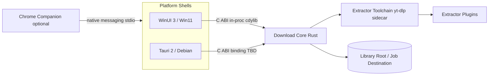
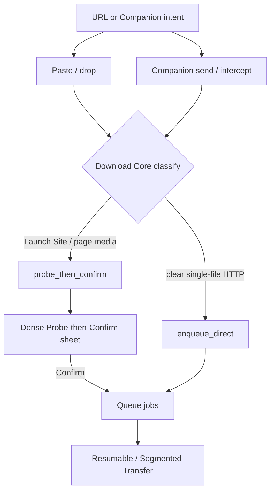
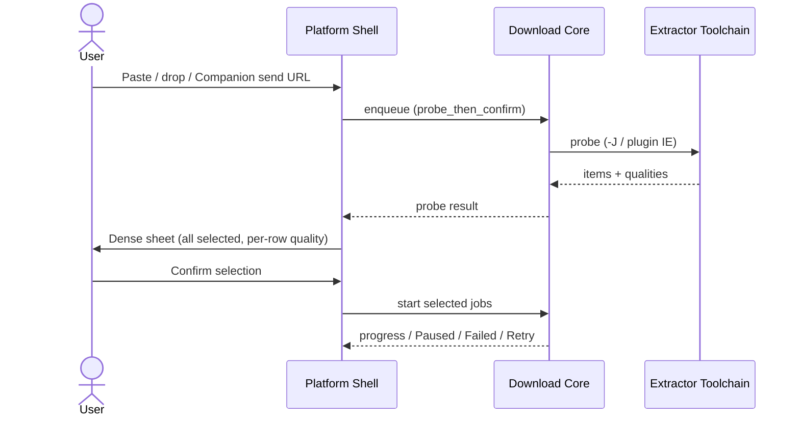
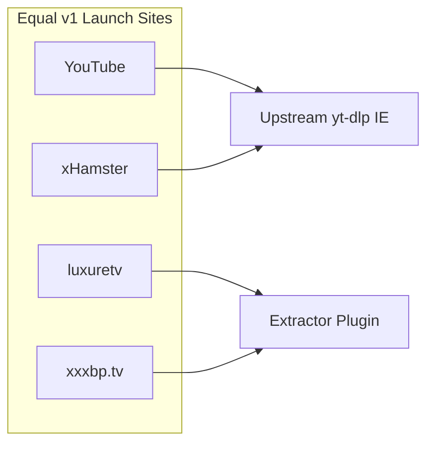

# Phlegethon hand-off spec

Product + engineering specification for implementation kickoff. Decisions locked on [Wayfinder: Phlegethon hand-off spec](https://github.com/soubarnak/phlegethon/issues/1) are recorded here once; research notes and UI prototypes are assets, not peer sources of truth.

**Status:** authored from locked decisions — awaiting human map sign-off on the wayfinder map (“hand-off accepted; implementation may start”).

---

## 1. Purpose & Destination

Phlegethon is a desktop **Download Manager** with first-class **Video Intelligence**, shipping on Windows 11 and Debian Linux. This document is the **Hand-off Spec**: clear enough that implementation can start without reopening locked product, platform, download-architecture, Launch Site, UI, and Companion decisions.

This effort does **not** build or ship the app. Implementation begins only after human sign-off on the map.

---

## 2. Vocabulary

Canonical terms live in [`CONTEXT.md`](../../CONTEXT.md). Spec language must match that glossary. Key terms used below: Download Manager, Video Intelligence, Launch Site, Download Core, Platform Shell, Extractor Toolchain, Extractor Plugin, Probe-then-Confirm, Library Root, Job Destination, Resumable Transfer, Segmented Transfer, Mirror Set, Bandwidth Cap, Chrome Companion, Hand-off Spec.

---

## 3. Product scope

### 3.1 What ships in v1 (desktop)

| Area | v1 commitment |
| --- | --- |
| Product shape | Universal download manager + video intelligence (not video-only) |
| Platforms | Windows 11 (WinUI 3 shell) + Debian (Tauri 2 shell); shared Rust Download Core |
| URL entry | Paste / drop URLs must work alone for desktop MVP |
| Launch Sites | Four equal must-haves: YouTube, xxxbp.tv, luxuretv, xHamster (see matrix) |
| HTTP depth | Resumable Transfer, Segmented Transfer, Mirror Sets, Bandwidth Caps; queue parity with video jobs |
| Storage | Library Root + per-job Job Destination; batch/channel → dedicated subfolder |
| Chrome Companion | Designed in this spec; **not required** for desktop MVP |

### 3.2 Launch Sites

Four sites are **equal v1 must-haves**. Minimum bar is single-video probe + quality list; multi-item lists where the site supports them and where this matrix requires them.

### 3.3 Non-goals

See [§ Non-goals](#non-goals) (map Out of scope set).

---

## 4. Platform & architecture

### 4.1 Shells

| OS | Platform Shell | UI toolkit |
| --- | --- | --- |
| Windows 11 | Native host | WinUI 3 (C#) |
| Debian | Native host | Tauri 2 (webview) |

Both shells talk to one shared Rust **Download Core** and share a Geist-inspired design system (tokens + recipes, native chrome per shell).

### 4.2 Windows ↔ Core (locked)

Embed the Download Core as a Rust `cdylib` (DLL), expose a thin **C ABI**, consume from WinUI 3 via **csbindgen** / `[LibraryImport]`, and stream queue/progress events through a rooted native callback into `System.Threading.Channels` (then the WinUI dispatcher).

**Escape hatch:** named-pipes sidecar (gRPC only if a protobuf IDL is wanted) when extractor/core crashes must not kill the shell.

**Not defaults:** UniFFI for C#; wrapping the core as a WinRT component.

Detail: [`docs/research/winui3-rust-core.md`](../research/winui3-rust-core.md).

### 4.3 Debian / Tauri ↔ Core

**Deferred:** how the shared C ABI is consumed from the Tauri/Debian shell. Windows path is locked; Linux binding details stay open (see [§ Deferred / open](#11-deferred--open)).

### 4.4 System context

---

## 5. Download Core behavior

### 5.1 Enqueue classification

The Download Core owns intent classification. Companion (when present) may tag a capture; the Core decides `enqueue_direct` vs `probe_then_confirm`.

| Source | Typical path |
| --- | --- |
| Paste / drop Launch Site or page-media URL | `probe_then_confirm` |
| Paste / drop clear single-file HTTP(S) | may `enqueue_direct` |
| Companion explicit send (URL ± session) | Core classifies; Launch Site pages never skip confirm |
| Companion download intercept | usually `enqueue_direct` for clear single-file HTTP |
| Companion direct media URL | plain HTTP / Resumable Transfer — **not** Launch Site Video Intelligence acceptance |

### 5.2 Enqueue paths diagram

### 5.3 Storage

- **Library Root** — user-chosen base directory for all downloads.
- **Job Destination** — per-job folder under the Library Root.
- Batch / channel jobs use a **dedicated subfolder** derived from the source.

### 5.4 Transfer behavior (all job types)

| Capability | v1 |
| --- | --- |
| Queue parity (video + general HTTP) | Same Library Root / Job Destination / Paused · Failed · Retry |
| Resumable Transfer | In — retry/backoff; explicit Paused / Failed / Retry until complete or discarded |
| Segmented Transfer | In — multi-connection Range when allowed; single-connection fallback |
| Mirror Sets | In — Metalink / `.meta4` + page-local lists + user-added URLs |
| Bandwidth Cap | In — optional global + per-job; default uncapped |
| Browser intercept into Phlegethon | Designed via Companion; not required for desktop MVP |

### 5.5 Probe-then-Confirm flow

Default multi-item UX: **dense sheet** — checklist + per-row quality, sticky Confirm, all selected by default. Downloads start only after explicit confirmation.

---

## 6. Extractor Toolchain

### 6.1 Packaging

Wrap official **yt-dlp** release binaries as a managed **sidecar** (CLI + `-J`/`-j` JSON probe). Prefer **nightly** updates (`-U` / `--update-to nightly` or app-fetched GitHub assets).

Also ship:

- **ffmpeg / ffprobe**
- For full YouTube: **yt-dlp-ejs** + a JS runtime

| OS | Binary shape |
| --- | --- |
| Win11 | `yt-dlp.exe` (ARM64 variant if needed) |
| Debian | `yt-dlp_linux` or zipimport `yt-dlp` + system Python |

Do not use you-get / gallery-dl as the primary toolchain; do not rely on Debian apt alone for Launch Site freshness.

Detail: [`docs/research/extractor-toolchain.md`](../research/extractor-toolchain.md).

### 6.2 Extractor Plugins

**luxuretv** and **xxxbp.tv** have no first-party yt-dlp extractors. Coverage is **Phlegethon-owned yt-dlp Extractor Plugins** shipped as app-managed sidecar assets, **updateable independently** of a full Win/Debian app release.

Native Download Core handlers only if a site cannot be expressed as a yt-dlp IE.

Post-ship plugin rot → **degraded Launch Site allowed** (explicit Failed / unsupported UX); fixes ship out-of-band via the plugin update path — do not freeze app releases on plugin rot.

### 6.3 Launch Site acceptance matrix

| Launch Site | Coverage mechanism | Single-video + quality | Multi-item lists |
| --- | --- | --- | --- |
| YouTube | Upstream yt-dlp (+ ejs/JS for full support) | **Required** | **Required** where supported (channel / playlist / user) |
| xHamster | Upstream yt-dlp | **Required** | **Required** where supported |
| luxuretv | Extractor Plugin | **Required** | Best-effort / later — **not** required for equal status |
| xxxbp.tv | Extractor Plugin | **Required** | Best-effort / later — **not** required for equal status |

### 6.4 Shared failure policy

1. **Hard-fail** the Launch Site path when the dedicated extractor / plugin cannot resolve the URL.
2. **No silent yt-dlp generic fallback** as “Launch Site supported.”
3. Degraded post-ship coverage is OK with explicit Failed / unsupported UX.
4. A Companion-fed **direct media URL** may enqueue as ordinary HTTP / Resumable Transfer; that does **not** count as Launch Site Video Intelligence acceptance.

---

## 7. Chrome Companion

Designed in this spec; **not required** for desktop MVP (paste/drop suffice).

### 7.1 Capability boundary (courier only)

1. **No in-browser Video Intelligence** — no probe or quality pick in the extension. Desktop always owns Probe-then-Confirm for Launch Site / page media URLs.
2. **Explicit send:** context menu on link, context menu on page, toolbar/action (current tab). Shortcuts / omnibox out of designed set.
3. **Opt-in download intercept** (default **off**). Unreachable / reject / cancel before job start → fall back to Chrome’s normal download. Explicit send always remains.
4. **Optional session handoff** via explicit per-send gesture (“Send with cookies” or equivalent). Intercept may attach same-origin session only after prior opt-in / first-intercept confirm. Exact cookie / session payload schema is deferred.
5. **Intent classification lives in Download Core** (see §5.1).

### 7.2 Transport

| Path | Role |
| --- | --- |
| Native messaging (stdio host) | **Sole** Companion ↔ desktop data path |
| Custom URI scheme | Launch / focus only — never session material |
| Extension-facing loopback HTTP | **Rejected** (LNA / CSRF) |

Installer registers Chrome **and** Chromium host locations; thin NMH forwards a versioned JSON envelope into the shell (named pipe / Unix socket).

Detail: [`docs/research/chrome-companion-bridge.md`](../research/chrome-companion-bridge.md).

---

## 8. UI flows

### 8.1 Design system

Share **Geist as tokens + recipes**, not as React components. Vendor `design.md` / `design.dark.md` as the token SoT; generate CSS variables for Tauri and XAML `ThemeDictionaries` (Light / Dark + system HighContrast) for WinUI 3. Embed the same OFL Geist Sans / Mono files on both shells; recolor native progress / queue rows via tokens (blue active, green done, red failed). Native chrome per shell — do not maintain separate Fluent vs ad-hoc web palettes.

Detail: [`docs/research/geist-winui-tauri.md`](../research/geist-winui-tauri.md).

### 8.2 Download queue (default chrome)

**Dense-row queue:** flat list, quiet batch section header, thin under-row progress, inline Pause / Resume / Retry, Geist-token surfaces, no cards.

When a batch header is present, expose **group Pause / Resume** on that header (secondary affordance — not a bordered tree / collapse-as-primary hierarchy).

**Rejected for v1:** split-inspector / master–detail queue chrome.

Artifact: [`prototypes/download-queue/`](../../prototypes/download-queue/) (`?variant=A`).

### 8.3 Probe-then-Confirm surface

**Dense sheet:** flat checklist with **per-row quality**, sticky Confirm footer, select-all default (all on). Visual language matches dense-row queue.

**Not v1 default:** bulk quality bar; two-pane layout.

Artifact: [`prototypes/probe-then-confirm/`](../../prototypes/probe-then-confirm/) (`?variant=A`).

### 8.4 Empty / error copy

Beyond clean progress bars and Failed / Retry states: exact offline / empty-state copy is **deferred** (see §11).

---

## 9. Packaging & trust

### 9.1 Locked packaging pieces

| Component | Expectation |
| --- | --- |
| yt-dlp sidecar | App-managed; prefer nightly; platform binaries per §6.1 |
| ffmpeg / ejs / JS runtime | Shipped beside toolchain as needed for Launch Sites |
| Extractor Plugins | App-managed sidecar assets; independently updateable |

### 9.2 Deferred packaging

Installers, auto-update, and code-signing expectations for Win11 + Debian (including trust / signing for independently updated Extractor Plugins + yt-dlp sidecar) are **open** — see §11. Implementation may start against the architectural locks above while packaging details are filled.

---

## Non-goals

Copied from the map Out of scope set — not v1 / not this effort:

- Web-wide hash/filename mirror search (v1 uses Metalink + page-local discovery only)
- Schedule-based bandwidth limits (e.g. nights-only) for v1
- Implementing or shipping the desktop app or extension inside the wayfinder map
- Research that relies on Google documentation or Google policy pages
- Sites beyond the four Launch Sites as v1 must-haves (may be listed as future extractors)
- macOS support
- Mobile clients
- Split-inspector / master–detail queue chrome for v1
- Silent yt-dlp generic fallback as Launch Site coverage for luxuretv / xxxbp.tv
- Chrome Companion required for desktop MVP
- In-browser quality-aware send; silent always-on cookies

---

## 10. Acceptance checklist

Map Destination bar — a reviewer walks this list against this file; human map sign-off is separate on [#1](https://github.com/soubarnak/phlegethon/issues/1).

| # | Criterion | Met? |
| --- | --- | --- |
| 1 | `docs/spec/hand-off.md` exists and follows the locked outline | Yes |
| 2 | All four required diagrams present | Yes (§4.4, §5.2, §5.5, §6.3) |
| 3 | Launch Site matrix + failure policy written | Yes (§6.3–6.4) |
| 4 | Every Decisions-so-far item reflected once (no reopen) | Yes (see decision index below) |
| 5 | Non-goals match the agreed set | Yes |
| 6 | Remaining fog resolved in-spec or listed under Deferred / open | Yes (§11) |
| 7 | Assets linked (`docs/research/`, `prototypes/`) | Yes (§12) |
| 8 | Human sign-off on the map: “hand-off accepted; implementation may start” | Pending |

### Decision index (Decisions so far → where reflected)

| Decision ticket | Spec home |
| --- | --- |
| [Grill: hand-off spec outline and acceptance bar](https://github.com/soubarnak/phlegethon/issues/8) | This document structure + §10 |
| [Grill: custom extractors for luxuretv and xxxbp.tv](https://github.com/soubarnak/phlegethon/issues/11) | §6.2–6.4 |
| [Prototype: Probe-then-Confirm selection surface](https://github.com/soubarnak/phlegethon/issues/10) | §5.5, §8.3 |
| [Prototype: clean download queue and progress](https://github.com/soubarnak/phlegethon/issues/9) | §8.2 |
| [Grill: Chrome Companion capability boundary](https://github.com/soubarnak/phlegethon/issues/7) | §7 |
| [Grill: general HTTP download depth for v1](https://github.com/soubarnak/phlegethon/issues/6) | §5.4 |
| [Research: Geist design system on WinUI 3 and Tauri](https://github.com/soubarnak/phlegethon/issues/5) | §8.1 |
| [Research: WinUI 3 shell talking to a Rust Download Core](https://github.com/soubarnak/phlegethon/issues/3) | §4.2 |
| [Research: Extractor Toolchain packaging and Launch Site coverage](https://github.com/soubarnak/phlegethon/issues/2) | §6.1, §6.3 |
| [Research: Chrome Companion to desktop bridge](https://github.com/soubarnak/phlegethon/issues/4) | §7.2 |

---

## 11. Deferred / open

In-scope fog carried forward from the map — may stay open without blocking map done:

| Topic | Notes |
| --- | --- |
| Tauri / Debian C ABI binding | Windows in-proc `cdylib` locked; Linux consumption of the shared C ABI TBD |
| Installers, auto-update, code-signing | Win11 + Debian; trust/signing for independently updated Extractor Plugins + yt-dlp sidecar |
| Offline / error UX copy and empty states | Beyond clean progress + Failed / Retry chrome |
| Companion cookie / session payload schema | Capability + transport locked; names / TTL / logging rules open |

---

## 12. Assets

### Research notes

| Note | Path |
| --- | --- |
| Extractor Toolchain packaging & Launch Site coverage | [`docs/research/extractor-toolchain.md`](../research/extractor-toolchain.md) |
| WinUI 3 ↔ Rust Download Core | [`docs/research/winui3-rust-core.md`](../research/winui3-rust-core.md) |
| Chrome Companion bridge | [`docs/research/chrome-companion-bridge.md`](../research/chrome-companion-bridge.md) |
| Geist on WinUI 3 + Tauri | [`docs/research/geist-winui-tauri.md`](../research/geist-winui-tauri.md) |

### Prototypes

| Prototype | Path | Locked variant |
| --- | --- | --- |
| Download queue UI | [`prototypes/download-queue/`](../../prototypes/download-queue/) | A — Dense rows (+ batch-header group Pause/Resume) |
| Probe-then-Confirm UI | [`prototypes/probe-then-confirm/`](../../prototypes/probe-then-confirm/) | A — Dense sheet |

### Glossary

| Asset | Path |
| --- | --- |
| Ubiquitous language | [`CONTEXT.md`](../../CONTEXT.md) |
